# Домашнее задание к занятию 6 «Создание собственных модулей» - Розаев А.Ю.

## Подготовка к выполнению

1. Создан пустой публичный репозиторий: `net-fops-hw-16-6`.
2. Скачан репозиторий Ansible: `git clone https://github.com/ansible/ansible.git`.
3. Выполнен переход в директорию Ansible: `cd ansible`.
4. Создано виртуальное окружение: `python3 -m venv venv`.
5. Активировно виртуальное окружение: `. venv/bin/activate`. Дальнейшие действия производятся только в виртуальном окружении.
6. Установлены зависимости `pip install -r requirements.txt`.
7. Запущена настройка окружения `. hacking/env-setup`.
8. Все шаги пройдены успешно — выполнен выход из виртуального окружения `deactivate`.

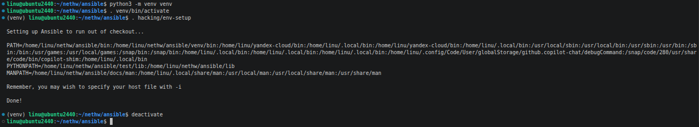

9. В дальнейшем, для запуска настроенного окружения в директории `ansible`, используется конструкция `. venv/bin/activate && . hacking/env-setup`.

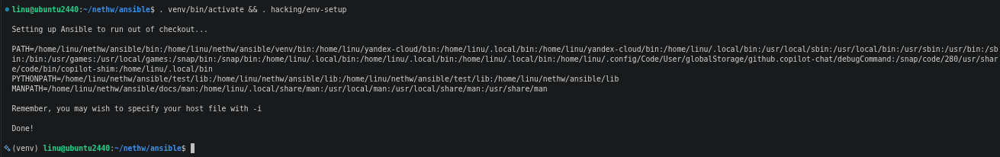

---

## Основная часть

Цель — написать собственный module, который можно использовать в своей role через playbook. Всё это должно быть собрано в виде collection и отправлено в репозиторий.

**Шаг 1.** В виртуальном окружении создан новый `my_own_module.py` файл.

**Шаг 2.** Файл наполнен содержимым:

<details>
<summary>module_conf</summary>

```python
#!/usr/bin/python

# Copyright: (c) 2018, Terry Jones <terry.jones@example.org>
# GNU General Public License v3.0+ (see COPYING or https://www.gnu.org/licenses/gpl-3.0.txt)
from __future__ import (absolute_import, division, print_function)
__metaclass__ = type

DOCUMENTATION = r'''
---
module: my_test

short_description: This is my test module

# If this is part of a collection, you need to use semantic versioning,
# i.e. the version is of the form "2.5.0" and not "2.4".
version_added: "1.0.0"

description: This is my longer description explaining my test module.

options:
    name:
        description: This is the message to send to the test module.
        required: true
        type: str
    new:
        description:
            - Control to demo if the result of this module is changed or not.
            - Parameter description can be a list as well.
        required: false
        type: bool
# Specify this value according to your collection
# in format of namespace.collection.doc_fragment_name
extends_documentation_fragment:
    - my_namespace.my_collection.my_doc_fragment_name

author:
    - Your Name (@yourGitHubHandle)
'''

EXAMPLES = r'''
# Pass in a message
- name: Test with a message
  my_namespace.my_collection.my_test:
    name: hello world

# pass in a message and have changed true
- name: Test with a message and changed output
  my_namespace.my_collection.my_test:
    name: hello world
    new: true

# fail the module
- name: Test failure of the module
  my_namespace.my_collection.my_test:
    name: fail me
'''

RETURN = r'''
# These are examples of possible return values, and in general should use other names for return values.
original_message:
    description: The original name param that was passed in.
    type: str
    returned: always
    sample: 'hello world'
message:
    description: The output message that the test module generates.
    type: str
    returned: always
    sample: 'goodbye'
'''

from ansible.module_utils.basic import AnsibleModule


def run_module():
    # define available arguments/parameters a user can pass to the module
    module_args = dict(
        name=dict(type='str', required=True),
        new=dict(type='bool', required=False, default=False)
    )

    # seed the result dict in the object
    # we primarily care about changed and state
    # changed is if this module effectively modified the target
    # state will include any data that you want your module to pass back
    # for consumption, for example, in a subsequent task
    result = dict(
        changed=False,
        original_message='',
        message=''
    )

    # the AnsibleModule object will be our abstraction working with Ansible
    # this includes instantiation, a couple of common attr would be the
    # args/params passed to the execution, as well as if the module
    # supports check mode
    module = AnsibleModule(
        argument_spec=module_args,
        supports_check_mode=True
    )

    # if the user is working with this module in only check mode we do not
    # want to make any changes to the environment, just return the current
    # state with no modifications
    if module.check_mode:
        module.exit_json(**result)

    # manipulate or modify the state as needed (this is going to be the
    # part where your module will do what it needs to do)
    result['original_message'] = module.params['name']
    result['message'] = 'goodbye'

    # use whatever logic you need to determine whether or not this module
    # made any modifications to your target
    if module.params['new']:
        result['changed'] = True

    # during the execution of the module, if there is an exception or a
    # conditional state that effectively causes a failure, run
    # AnsibleModule.fail_json() to pass in the message and the result
    if module.params['name'] == 'fail me':
        module.fail_json(msg='You requested this to fail', **result)

    # in the event of a successful module execution, you will want to
    # simple AnsibleModule.exit_json(), passing the key/value results
    module.exit_json(**result)


def main():
    run_module()


if __name__ == '__main__':
    main()
```

</details>

Или можно использовать наполнение [из статьи](https://docs.ansible.com/ansible/latest/dev_guide/developing_modules_general.html#creating-a-module).

**Шаг 3.** Файл заполнен в соответствии с требованиями Ansible так, чтобы он выполнял основную задачу: module должен создавать текстовый файл на удалённом хосте по пути, определённом в параметре `path`, с содержимым, определённым в параметре `content`.

**Шаг 4.** Module проверен на исполняемость локально.

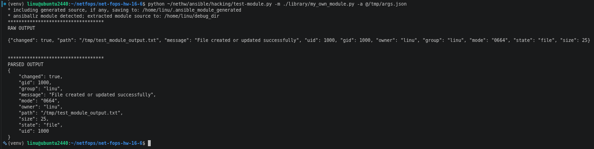

**Шаг 5.** Написан single task playbook и использован module в нём.

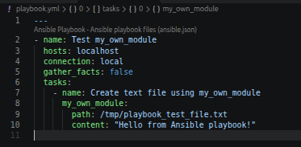

**Шаг 6.** Проверен через playbook на идемпотентность.

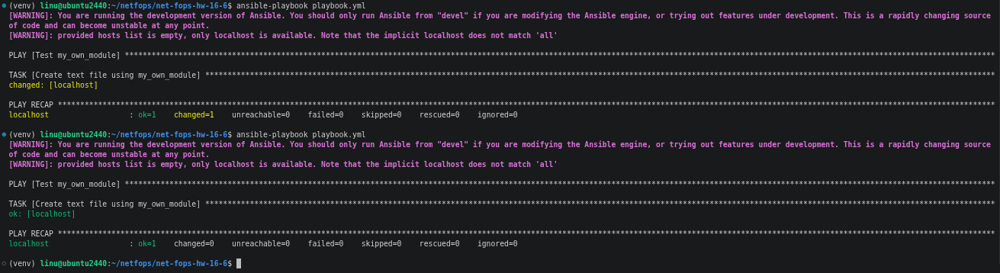

**Шаг 7.** Выйполнен выход из виртуального окружения.

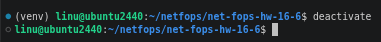

**Шаг 8.** Инициализирована новая collection: `ansible-galaxy collection init my_own_namespace.yandex_cloud_elk`.

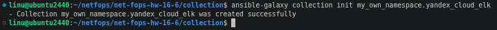

**Шаг 9.** В созданную collection перенесен ранее созданный module в соответствующую директорию.

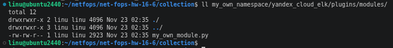

**Шаг 10.** Single task playbook преобразован в single task role и перенесен в collection. У role в default все параметры module.

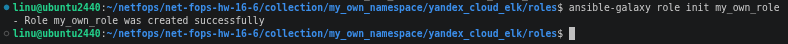

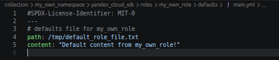

**Шаг 11.** Создан playbook для использования этой role.

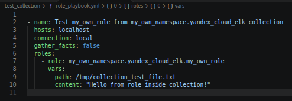

**Шаг 12.** Заполнена вся документация по collection, выложена в репозиторий, поставлен тег `1.0.0` на этот коммит.

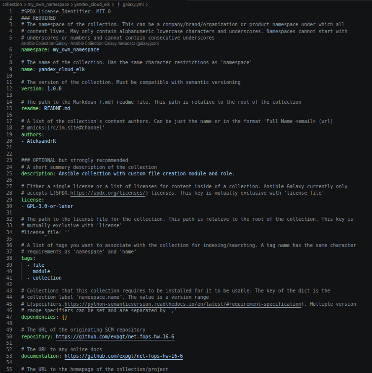

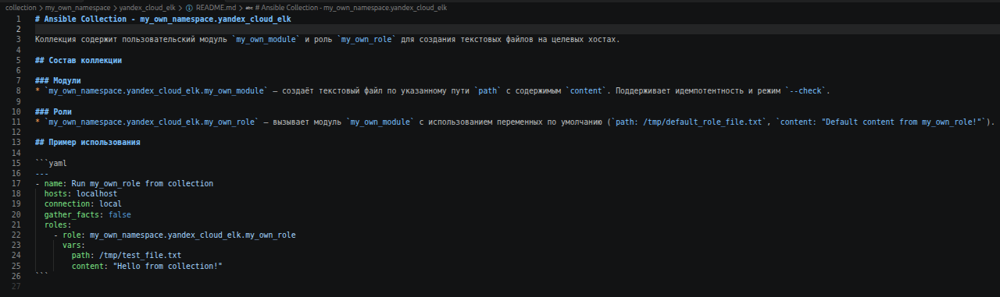

**Шаг 13.** Создан .tar.gz этой collection: `ansible-galaxy collection build` в корневой директории collection.

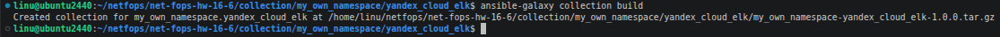

**Шаг 14.** Создана ещё одна директория, перенесены туда single task playbook и архив c collection.

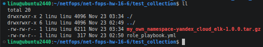

**Шаг 15.** Установлена collection из локального архива: `ansible-galaxy collection install <archivename>.tar.gz`.

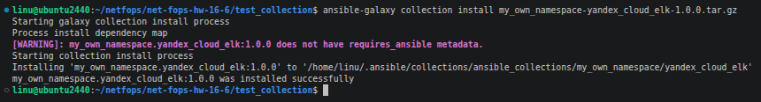

**Шаг 16.** Запущен playbook - работает.

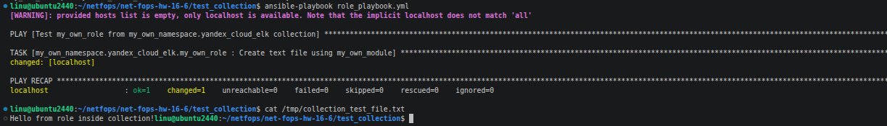

**Шаг 17.** Ссылки на collection и tar.gz архив, а также скриншоты выполнения пунктов 4, 6, 15 и 16.

[collection](https://github.com/expgt/net-fops-hw-16-6/blob/main/collection)

[tar.gz](https://github.com/expgt/net-fops-hw-16-6/blob/main/test_collection/my_own_namespace-yandex_cloud_elk-1.0.0.tar.gz)


---

## Необязательная часть

1. Выполнена реализация модуля для создания хостов в Yandex Cloud.
2. Модуль имеет зависимость от `yc`, основной функционал: создание ВМ с нужным сайзингом на основе нужной ОС.
3. Модуль формирует динамическое inventory `generated_inventory.yml`.
4. Модуль протестирован на идемпотентность, исполнимость. Модуль добавлен в коллекцию.

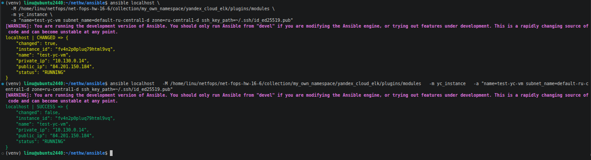

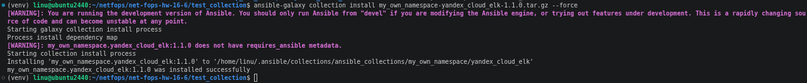

5. Playbook изменен так, чтобы он мог создавать инфраструктуру под inventory, а после устанавливал весь стек Observability на нужные хосты и настраивал его.

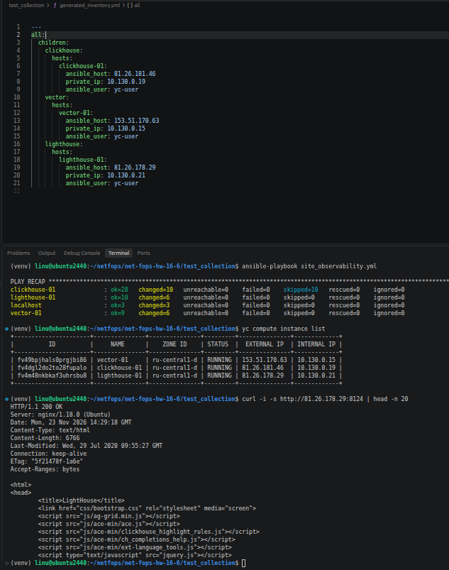

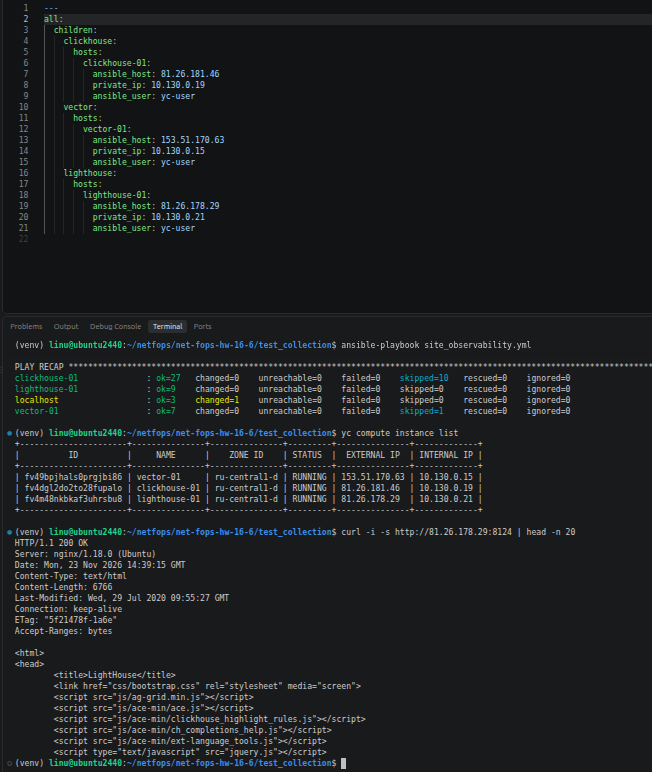

6. В итоге коллекция содержит: clickhouse-role, lighthouse-role, vector-role, два модуля: my_own_module и модуль управления Yandex Cloud хостами и playbook, который демонстрирует создание Observability стека.

---
